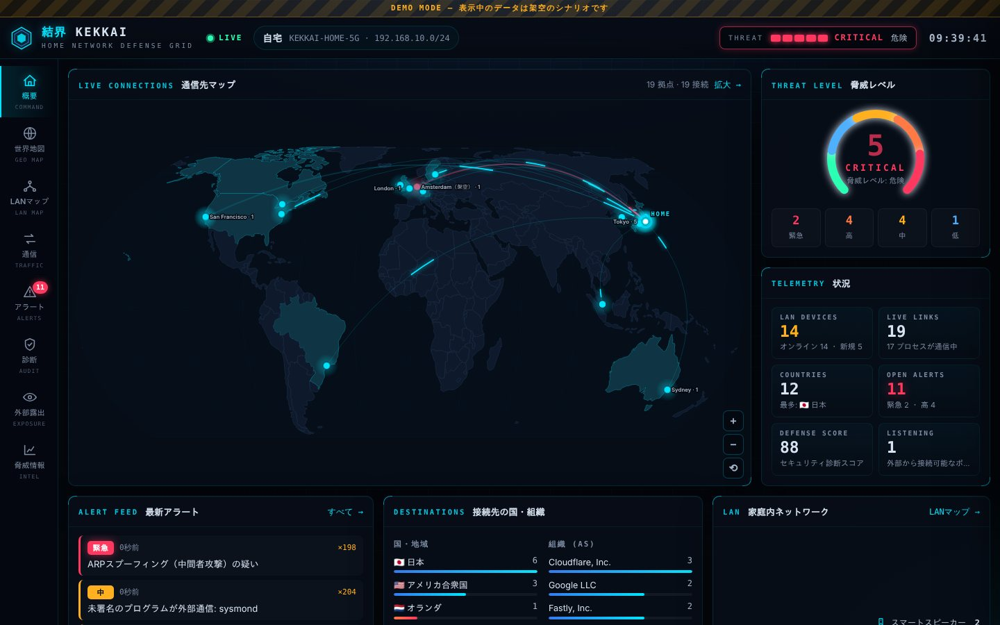
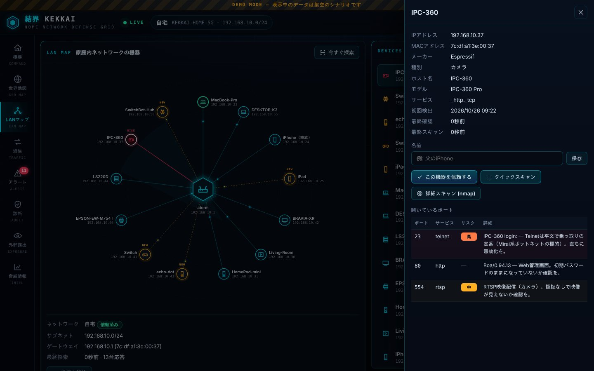
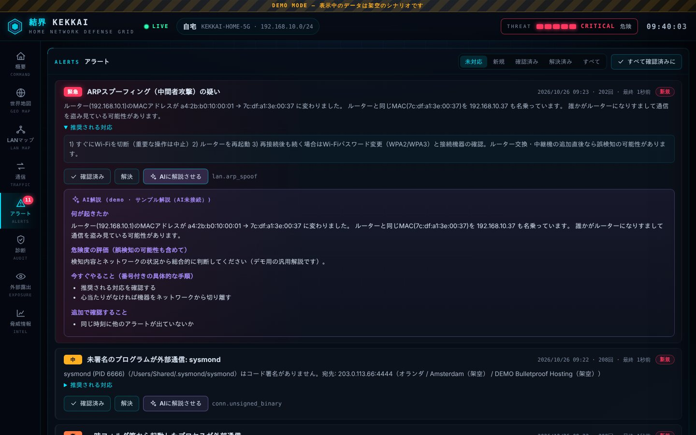

# 結界 KEKKAI — 自宅ネットワーク防御コンソール（macOS）

自宅のネットワークとMacを「結界」で囲み、**不正アクセス・乗っ取り・情報の抜き取り**の兆候を監視するツールです。
Kali Linux の定番ツール（nmap / netdiscover / arpwatch / tcpdump / Snort / Lynis）の考え方を、
**守る側**に特化して1つのダッシュボードにまとめました。



| LANマップ（機器とポートスキャン） | アラートとAI解説 |
|---|---|
|  |  |

> スクリーンショットは `./kekkai serve --demo` の**架空のデータ**です（侵入シナリオを再生するデモモード）。

---

## できること

| 機能 | 内容 | 参考にした Kali のツール |
|---|---|---|
| 🌐 **世界地図** | Macの通信先をリアルタイムに地図へ描画。国・都市・組織(AS)・プロセスまで表示。危険な通信は赤く光ります | Wireshark の GeoIP 表示 |
| 🏠 **LANマップ** | 自宅のルーターと全機器を放射状に表示。メーカー・機種・種別を自動判定し、新しい機器を検知 | netdiscover / arp-scan / Zenmap |
| 🔍 **ポートスキャン** | LAN内の機器の開いているポートを調べ、Telnet・ADB・Docker等の危険なサービスを指摘（nmap があれば `-sV` で詳細） | nmap |
| 🛡 **侵入検知** | ARPスプーフィング（中間者攻撃）、脅威リスト掲載IPとの通信、一時フォルダから動く未署名プログラム、新しい自動起動項目、DNS/プロキシの書き換えなど | arpwatch / Snort / KnockKnock |
| 📡 **パケットセンサー**（任意） | `sudo` で起動すると、このMacへのポートスキャン、LAN内の偵察（ARPスキャン）、ルーターなりすまし、危険ドメインへの名前解決をリアルタイム検知 | tcpdump / Snort |
| ✅ **セキュリティ診断** | ファイアウォール・FileVault・SIP・Gatekeeper・自動アップデート・共有設定・Wi-Fi暗号化・バックアップ等を採点 | Lynis |
| 👁 **外部露出チェック** | 「インターネットから自宅がどう見えるか」を Shodan InternetDB で確認。ルーターの UPnP ポート開放も一覧化 | Shodan |
| 🤖 **AIアナリスト** | アラートを日本語で解説し、具体的な対処手順を提案。**ローカルLLM（Ollama / LM Studio）ならデータがMacの外に出ません**。Claude も利用可 | — |
| 🧩 **Claude 連携** | MCPサーバー内蔵。Claude Code / Claude Desktop から「うちのネットワーク大丈夫？」と聞けます | — |
| 🩺 **自己診断** | ツール自身の不具合（収集失敗・データの古さ・権限不足）を検出 | — |

### 検知ルール

| ルール | 重大度 | 内容 |
|---|---|---|
| `lan.arp_spoof` | 緊急/高 | ルーターのMACアドレスが変わった／他の機器がルーターを名乗っている（中間者攻撃の典型） |
| `conn.threat_feed` | 緊急〜中 | ボットネットC2・侵害済みホスト等の脅威リストに載ったIPとの通信 |
| `conn.suspicious_binary` | 高 | /tmp・/Users/Shared・隠しフォルダ等から起動したプログラムが外部通信 |
| `conn.unsigned_binary` | 中 | コード署名のないプログラムが外部通信 |
| `conn.suspicious_port` | 中 | 4444・6667・23 などマルウェアが好むポートへの外部通信 |
| `conn.tor` | 中/低 | Tor出口ノードとの通信（外部からの接続は中） |
| `lan.new_device` | 中/低 | 自宅ネットワークに新しい機器が参加 |
| `lan.risky_service` | 緊急/高 | スキャンで危険なサービス（Telnet, ADB, Docker API, Redis…）を発見 |
| `host.new_listener` | 高〜低 | このMacで新しい待ち受けポートが開いた（SSH・画面共有などは高） |
| `host.persistence_new` | 高〜低 | LaunchAgents/Daemons（自動起動）が追加・変更された |
| `host.dns_changed` | 高/低 | DNSサーバーが未知のものに変わった（DNSハイジャック） |
| `host.proxy_enabled` | 高 | プロキシ/PACが有効になった（通信の盗み見） |
| `exposure.*` | 高〜低 | インターネットから見えるポート・CVE、UPnPによるポート開放 |
| `wifi.*` | 高/中 | 暗号化なし・WEPのWi-Fi、同名の偽アクセスポイント |
| `sensor.*` | 緊急/高 | ポートスキャン、ARPスキャン、ARP偽装、危険ドメイン（センサー起動時） |

誤検知を減らすため、最初の数サイクルは**学習モード**（ベースライン作成）で、通知はしません。
自宅以外（カフェ等）のネットワークでは「新しい機器」の通知を出さず、代わりに共有機能の公開を警告します。

---

## はじめかた（Mac）

必要なもの: macOS（Apple Silicon / Intel）、Python 3.9以上（追加パッケージ不要）

```sh
# 1) git と python3 が無ければ（初回のみ）
xcode-select --install

# 2) 取得
git clone https://github.com/YSK3000/ysk.git
cd ysk/kekkai

# 3) 初期セットアップ（GeoIP・MACベンダー・脅威リストを取得して自己診断）
./kekkai setup

# 4) 起動（ブラウザでダッシュボードが開きます）
./kekkai serve
```

Finder から `KEKKAI.command` をダブルクリックしても起動できます。まず雰囲気を見たいときは `./kekkai serve --demo`。

### あると便利なもの（任意）

| 追加するもの | コマンド | 効果 |
|---|---|---|
| nmap | `brew install nmap` | 「詳細スキャン」でサービスのバージョンまで特定 |
| Ollama + モデル | `brew install ollama` → `ollama serve` → `ollama pull qwen3:8b` など | AI解説をMac内で完結（MacBook Proなら快適） |
| Claude（クラウド） | `python3 -m pip install anthropic` ＋ `ANTHROPIC_API_KEY` | ローカルLLMが無いときのAI解説（MACアドレス等は伏せて送信） |
| パケットセンサー | 別ターミナルで `sudo ./kekkai sensor` | ポートスキャン・ARP偽装のリアルタイム検知 |
| 自動起動 | `./kekkai install-agent` | ログイン時にバックグラウンド起動（`./kekkai open` で表示） |

> **macOS 15 以降の注意**: ターミナルから起動した場合は問題ありませんが、自動起動（install-agent）では
> 「ローカルネットワーク」の許可でLAN探索が止まることがあります。`./kekkai doctor` が検出するので、
> 表示されたら システム設定 > プライバシーとセキュリティ > ローカルネットワーク で許可してください。

### コマンド一覧

```text
./kekkai serve [--demo] [--port N]   監視＋ダッシュボード
./kekkai open                        起動中のダッシュボードを開く
./kekkai scan                        LAN内の機器を探索して一覧表示
./kekkai conns [--risky]             このMacのインターネット通信
./kekkai alerts [--all]              アラート一覧
./kekkai audit [--detailed]          セキュリティ診断（--detailed で未適用アップデートも確認）
./kekkai exposure                    インターネットから見た自宅
./kekkai portscan 192.168.1.20 [--deep]  LAN内機器のポートスキャン（プライベートIPのみ）
./kekkai lookup 1.2.3.4 [--external] IPの照会（GeoIP・脅威リスト・Shodan/GreyNoise）
./kekkai report [--out report.md]    Markdownレポート（家族やAIへの相談用）
./kekkai update [--force]            GeoIP・脅威リストの更新（自動でも12時間ごと）
./kekkai doctor                      自己診断
sudo ./kekkai sensor                 パケットセンサー
./kekkai mcp                         MCPサーバー（Claude 連携）
```

すべてのコマンドに `--json` 出力があり（serve/mcp等を除く）、スクリプトやAIから扱えます。

---

## Claude と連携する

### Claude Code

このリポジトリには、プロジェクト用の `.mcp.json`、調査手順のスキル（`.claude/skills/kekkai-triage`）、
専用サブエージェント（`.claude/agents/kekkai-analyst.md`）が入っています。リポジトリのルートで `claude` を起動すれば使えます。
どこからでも使いたい場合:

```sh
claude mcp add -s user kekkai -- "$HOME/ysk/kekkai/kekkai" mcp
```

例: 「KEKKAIのアラートを調べて、危ないものから対処法を教えて」「LANに知らない機器いる？」

### Claude Desktop

`~/Library/Application Support/Claude/claude_desktop_config.json` に追加:

```json
{ "mcpServers": { "kekkai": { "command": "/Users/あなた/ysk/kekkai/kekkai", "args": ["mcp"] } } }
```

MCPツール: `kekkai_status` `kekkai_alerts` `kekkai_connections` `kekkai_devices` `kekkai_lookup_ip`
`kekkai_scan_device`（LAN内のみ） `kekkai_audit` `kekkai_exposure` `kekkai_report` `kekkai_doctor` `kekkai_set_alert_status`

---

## このツール自体の安全設計

監視ツールが新しい穴にならないよう、次のようにしています。

- ダッシュボードは **127.0.0.1 のみ**で公開。合言葉（ランダムなトークン）付きURLでしか開けません
- Host ヘッダー検査（DNSリバインディング対策）、Origin/Sec-Fetch-Site 検査（CSRF対策）、厳格な CSP（インラインスクリプト禁止）
- LANの機器名（mDNS/UPnP由来）は攻撃者が自由に付けられるため、画面にはテキストとしてのみ描画（HTMLとして解釈しない）
- UPnPの機器情報は**応答した機器自身のURLだけ**を取得し、XMLのDTD/エンティティを拒否
- ポートスキャンは**プライベートIP（自宅LAN）だけ**に制限（CLI・ダッシュボード・MCPすべて）
- 外部コマンドはシェルを通さず引数で実行。macOS通知も AppleScript への埋め込みをしない方式
- パケットセンサーはヘッダーとDNSの問い合わせ名だけを見ます（通信内容は読みません）
- センサーは5秒ごとに生存信号を書き、別のネットワーク（自宅→カフェ等）へ移ると新しいルーター情報で監視をやり直します。
  同じネットワークのまま「ルーターのMAC」だけが変わった場合は乗っ取りの疑いとして扱い、最初に覚えたMACを信じ続けます
- 依存パッケージなし（Python標準ライブラリのみ）。サプライチェーン攻撃の入口を減らしています

## 外部との通信（プライバシー）

| 通信先 | 目的 | 止め方 |
|---|---|---|
| download.db-ip.com / jsDelivr | GeoIP・ASNデータの取得（月1回程度） | — |
| standards-oui.ieee.org | MACアドレスのメーカー表 | — |
| abuse.ch / Spamhaus / Emerging Threats / FireHOL(GitHub) / CINS / Tor Project | 脅威リスト（12時間ごと） | `config.json` の `intel.feeds` |
| api.ipify.org 等 / internetdb.shodan.io | 自宅の公開IPと外部露出の確認（6時間ごと） | `privacy.external_lookups: false` |
| GreyNoise / AbuseIPDB | IP照会で「外部情報」を押したときだけ | 押さない |
| Anthropic API | AIプロバイダに Claude を選んだときだけ | ローカルLLMを使う |

設定とデータは `~/Library/Application Support/KEKKAI/`（`config.json`, `kekkai.db`）にあります。

## 不具合を自分たちで見つけて直す仕組み

- `./kekkai doctor` — 収集処理・パーサー・データ鮮度・権限・AI接続を自己診断（ダッシュボードの「脅威情報」画面からも実行可）
- ダッシュボードの「自己診断」表 — 監視ループごとの実行回数・エラー・所要時間を常時表示
- 単体テスト 60件以上（Python標準の unittest。Macでもそのまま実行可）:
  `cd kekkai && python3 -m unittest discover -s tests`
- GitHub Actions で **本物のmacOS** 上の動作を毎回検証（`.github/workflows/kekkai.yml`）。
  macOSの実コマンド出力とパーサーの結果を突き合わせ、実データのダウンロード・サーバー・MCP・センサーまで確認します
- デモモード（`--demo`）は本物の検知エンジンに侵入シナリオを流す統合テストも兼ねています

## できないこと（正直な制限）

- **通信の遮断はしません**（監視と通知のみ）。遮断したい場合は LuLu 等のアプリ型ファイアウォールを併用してください
- Wi-Fi接続のMacからは、**他の機器同士の通信内容は見えません**（LAN内の他機器の監視は、ARP・mDNS・UPnP・スキャンでの間接的な把握です）
- 脅威リストに載っていない新しい攻撃先は検知できません。CDNや共有ホスティングでは誤検知もあり得ます
- Shodan InternetDB は週1回更新で、IPv4を共有する回線（v6プラス/transix等）では他の利用者の情報が混ざることがあります
- GeoIPの位置は「おおよそ」です（特にモバイル回線・VPN）
- ARPスプーフィング検知は監視の間隔（既定15秒）またはセンサー起動時に限られます
- センサーのポートスキャン検知は IPv4 のみです（IPv6 宛てのスキャンは対象外。危険ドメイン検知は IPv6 の DNS も見ます）

## 出典・ライセンス

KEKKAI 本体は Unlicense。地図データは Natural Earth / world-atlas、国名は i18n-iso-countries、
IP位置情報は **IP Geolocation by DB-IP**（CC BY 4.0）。詳細は [THIRD_PARTY_NOTICES.md](THIRD_PARTY_NOTICES.md)。
